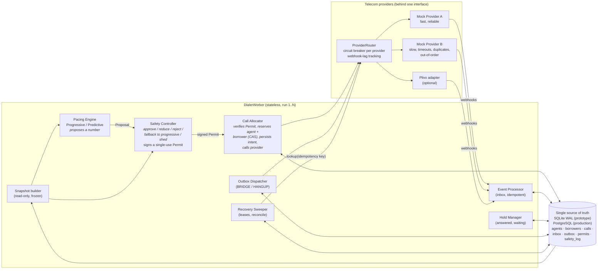
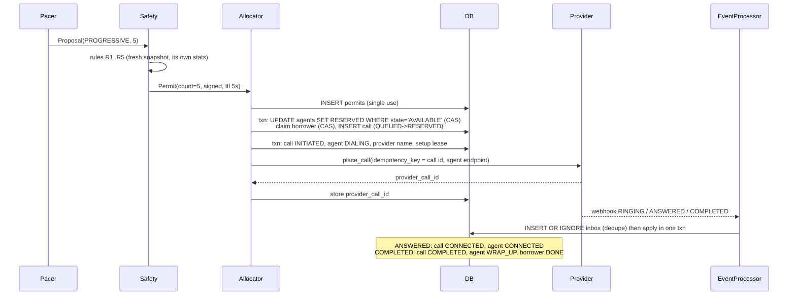

# Architecture

## 1. The pipeline

The assignment asks for this pipeline:

```
Campaign > Pacing Engine (Progressive / Predictive) > Safety Controller > Call Allocator > Telecom Provider
```

This is how it is built:



ASCII version for terminals:

```
               +-------------------- DialerWorker (x N, stateless) ---------------------+
               |                                                                        |
  +------+     |  Snapshot --> Pacing Engine --Proposal--> Safety Controller --Permit--> Call Allocator ---> ProviderRouter --> Provider A / B / Plivo
  |  DB  |<--->|  (frozen)     (proposes only)            (approve/reduce/reject/        (CAS reserve,      (breakers,            |
  |      |     |                                           fallback/shed; HMAC)           intent first)       webhook lag)          |
  |single|     |                                                                                                                  | webhooks
  |source|<--->|  Event Processor (inbox, dedupe, monotonic)  <------------------------------------------------------------------+
  |  of  |<--->|  Hold Manager (answered predictive calls wait <= 2 s for an agent)
  |truth |<--->|  Outbox Dispatcher (BRIDGE / HANGUP, at-least-once, idempotent)
  +------+<--->|  Recovery Sweeper (expired leases -> roll back or reconcile with provider.lookup)
               +--------------------------------------------------------------------------------+
```

## 2. Components

| Component | File | Responsibility | Can it place a call? |
|---|---|---|---|
| Store | `smartdialer/store.py` | Schema, transactions, compare-and-set updates, DB-enforced invariants | no |
| State machines | `smartdialer/states.py` | Allowed agent/call transitions; call rank (monotonic) | no |
| Lifecycle | `smartdialer/lifecycle.py` | Multi-entity transitions in one transaction (call end, bind on answer, agent disappears) | no |
| Snapshot | `smartdialer/snapshot.py` | Frozen read-only view of a campaign | no |
| Pacing engines | `smartdialer/pacing.py` | `ProgressivePacer`, `PredictivePacer` produce a `Proposal(mode, count, rationale)` | **no** - no reference to allocator or providers |
| Safety Controller | `smartdialer/safety.py` | Turns a proposal into a `Decision` + HMAC-signed single-use `Permit` | no (only it can authorise) |
| Call Allocator | `smartdialer/allocator.py` | Verifies permit, reserves agent + borrower, persists intent, calls the provider | yes - **only with a valid permit** |
| Providers | `smartdialer/providers/` | Interface, mock A & B, circuit breaker + router, optional Plivo adapter | (the provider is the phone network) |
| Event Processor | `smartdialer/events.py` | Inbox, dedupe, idempotent apply; Hold Manager; Outbox Dispatcher | no |
| Recovery Sweeper | `smartdialer/recovery.py` | Leases expired -> roll back or roll forward | no |
| Worker | `smartdialer/worker.py` | One tick = events -> outbox -> holds -> sweep -> (leader) pace | - |

## 3. One call, step by step (progressive)



Predictive is the same except the call row has **no agent**. The agent is bound when `ANSWERED` is processed
(`Lifecycle.bind_free_agent`, a CAS on any AVAILABLE agent) and a `BRIDGE` command is written to the outbox in the
same transaction. If nobody is free, the call waits in `ANSWERED` for at most `max_hold_s = 2 s`; then it is
`ABANDONED` (counted, borrower not re-dialled for 72 h) and hung up.

## 4. Concurrency: how two workers are prevented from reserving the same agent

The question from the assignment: *two workers see the same available agent at almost the same time.*

1. Both run `SELECT id FROM agents WHERE state='AVAILABLE' ORDER BY state_since LIMIT 1` and both get `agent-7`.
2. Both run `UPDATE agents SET state='RESERVED', version=version+1, ... WHERE id='agent-7' AND state='AVAILABLE'`.
3. The database serialises the two writes (SQLite: one writer at a time via `BEGIN IMMEDIATE`; PostgreSQL: row lock).
   The first UPDATE matches 1 row. The second one re-evaluates `state='AVAILABLE'` against the committed row,
   which is now `RESERVED`, and matches **0 rows**.
4. The loser sees `rowcount == 0`, picks the next agent. No locks were held across network calls; nobody waited
   on anybody's memory.

Backstops if application code were ever wrong:
* `ux_one_active_call_per_agent` - a partial UNIQUE index: an agent can be on at most one non-terminal call.
* `ux_one_active_call_per_borrower` - same for borrowers, so a borrower is never dialled twice at once.

Tested by `tests/test_concurrency.py` (20 threads at a barrier on one agent; 8 OS processes on 25 agents) and by the
load test (8 processes, ~26,000 reservations, **0 overlapping holds**).

In PostgreSQL the pick would be `SELECT ... FOR UPDATE SKIP LOCKED LIMIT n` so competing workers take *different*
agents instead of all fighting for the longest-idle one (see SCALING.md).

**"The database says AVAILABLE but the cache says RESERVED - which wins?"** The database. There is deliberately no
cache in the decision path. If a cache were added for dashboards, it would be a read-only projection; reservations
always go through the CAS on the database row. A cache can make you *skip* an agent (harmless, it gets picked next
tick) but can never make you *double-book* one.

## 5. Multiple workers

| Concern | How it is handled |
|---|---|
| Agent allocation | CAS on the agent row + unique index (above) |
| Borrower allocation | CAS on the borrower row (`state='PENDING'` + `version`) + unique index on active calls |
| Duplicate jobs | Pacing is done by one leader per campaign (`acquire_pacing_lease`, 3 s lease with a fencing epoch). Even if two leaders overlap, permits are single-use and the predictive cap is re-checked inside the transaction that creates each call |
| Retries | `place_call` carries an idempotency key = our call id. Timeouts are never blindly retried; they are reconciled with `provider.lookup(key)` |
| Idempotency | Inbox `UNIQUE(provider, event_id)`; outbox `UNIQUE(dedupe_key)`; provider commands idempotent |
| Concurrent updates | Every update is conditional on the expected state/version |
| Worker crashes | Workers hold no state. Leases (agent reservation, call setup, borrower claim, pacing) expire; any worker's sweeper rolls back or forward |
| Stale state | A worker that wakes up after its lease expired fails its CAS (state/version moved on). The pacing epoch is a fencing token |
| Provider events | Webhooks can be received by any worker: they are stored durably first, applied idempotently later |

Everything except pacing is safe to run on every worker at the same time.

## 6. Failure cases (summary - details in `docs/reports/FAILURE_DEMOS.md`)

| Case | What happens |
|---|---|
| **Worker crash** after agent reserved > borrower reserved > call initiated | `INITIATED` was committed *before* calling the provider. After the 8 s setup lease expires, any worker asks `provider.lookup(idempotency_key)`. Found -> adopt the provider call id, feed its status through the normal event path, the call continues. Not found -> `FAILED`, agent `AVAILABLE`, borrower `PENDING` (attempt not counted). Provider unreachable -> keep the agent held up to 30 s, then give up, release the agent and queue an idempotent `HANGUP` that the outbox keeps retrying |
| **Provider outage** | *New calls*: breaker opens after >=50% failures (min 5 samples) in 30 s; router fails over to the next provider; if none healthy the safety controller rejects; after 15 s one probe call (half-open). *Existing calls*: keep being driven by their webhooks; if webhooks stop, the sweeper reconciles after 90 s. *Retries*: `place_call` timeouts are reconciled, never blind-retried; provider faults don't use up the borrower's attempts and back off exponentially. *Pacing*: the predictive mode requires a provider whose webhooks are fast; if the fast provider is out the campaign drops to progressive automatically |
| **Agents suddenly drop** (100 -> 60 in 3 s) | Agent logout is an event in the DB; the next pacing tick (1 s) sees it, switches to `FALLBACK_PROGRESSIVE` for 60 s and cancels the newest ringing calls the remaining agents can't absorb. Agents that vanish *during call setup* are swapped for another free agent, or the call is cancelled and hung up before it is answered |
| **Duplicate events** | Exact duplicates are rejected by the inbox unique key; re-sends with a new id hit the monotonic state machine and become `stale` no-ops |
| **Out-of-order events** | Call states only move forward (rank). `COMPLETED, ANSWERED, RINGING` ends `COMPLETED`; late events are recorded as `stale`. `COMPLETED` carries `answered`/`bridged`, so the right terminal state is chosen even if `ANSWERED` never arrived |
| **Crash right after ANSWERED** | Either the event is still unprocessed in the inbox (a new worker applies it) or the apply transaction rolled back (nothing half-done). If the agent bind committed but the BRIDGE was not sent, the outbox sends it |
