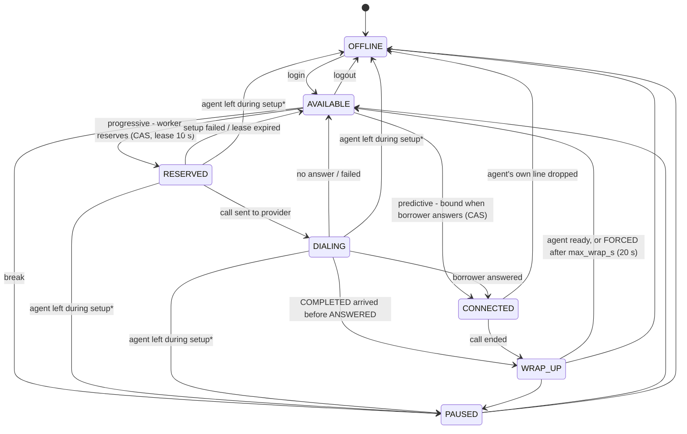
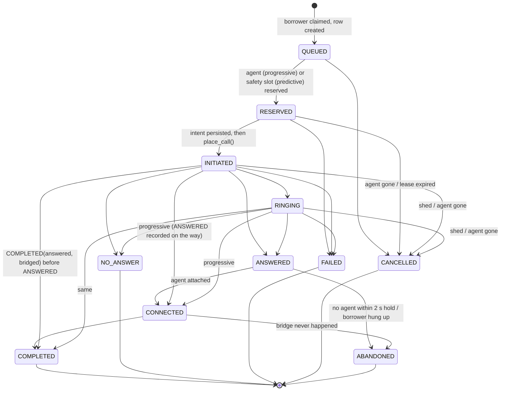

# State machines

Source of truth: `smartdialer/states.py`. The store refuses any transition not listed there.

## Agent

\* When an agent leaves while RESERVED/DIALING for an unanswered call, `Lifecycle.agent_set_state` first tries to
**swap in another free agent** for that call; if none is free the call is **cancelled and hung up before the
borrower answers**.

Notes
* `RESERVED` is the moment the agent becomes unavailable to every other worker. It always carries a lease
  (`lease_owner`, `lease_until`) so a crashed worker cannot hold an agent forever.
* `WRAP_UP` has a forced end. That makes "agent will be free in X seconds" much more predictable, so the safety
  controller counts such agents as capacity (they could still choose PAUSED, which epsilon and the hold cover).

## Call

### The one rule that makes bad provider behaviour harmless

Every call state has a **rank**:

| QUEUED | RESERVED | INITIATED | RINGING | ANSWERED | CONNECTED | terminal (COMPLETED, NO_ANSWER, FAILED, CANCELLED, ABANDONED) |
|---|---|---|---|---|---|---|
| 0 | 1 | 2 | 3 | 4 | 5 | 10 |

A transition is applied only if it is listed **and** moves to a strictly higher rank. Terminal states are sticky.

| Provider sends | Result |
|---|---|
| ANSWERED, ANSWERED, ANSWERED, COMPLETED | The first ANSWERED moves the call to CONNECTED. Duplicate with the same id: rejected by the inbox. Re-send with a new id: ANSWERED -> ANSWERED is not "forward", so it is a no-op (`stale`). COMPLETED -> terminal. Agent goes to WRAP_UP once |
| COMPLETED, ANSWERED, RINGING | COMPLETED is applied (to COMPLETED, NO_ANSWER or ABANDONED depending on its `answered`/`bridged` payload). ANSWERED and RINGING are stale no-ops |
| ANSWERED, then the worker crashes | The webhook was stored in the inbox before it was acknowledged. Either it was never applied (another worker applies it) or the apply transaction rolled back (nothing half-done) |

### Mapping provider events to transitions (`events.py`)

| Event | Current call state | New state | Side effects |
|---|---|---|---|
| RINGING | INITIATED | RINGING | - |
| ANSWERED | progressive, agent DIALING | ANSWERED -> CONNECTED | agent DIALING -> CONNECTED (provider bridges the pre-assigned agent itself) |
| ANSWERED | predictive | ANSWERED -> CONNECTED if a free agent was bound, else stays ANSWERED (hold 2 s) | agent AVAILABLE -> CONNECTED; BRIDGE in outbox |
| COMPLETED | CONNECTED | COMPLETED (bridged) or ABANDONED (not bridged) | agent -> WRAP_UP; borrower DONE |
| COMPLETED | ANSWERED (waiting) | ABANDONED | borrower cool-down 72 h |
| COMPLETED | INITIATED/RINGING | COMPLETED if answered+bridged (progressive), ABANDONED if answered not bridged, else NO_ANSWER | agent released/wrap-up |
| NO_ANSWER / FAILED | any non-terminal | NO_ANSWER / FAILED | agent AVAILABLE; borrower retry rules |
| anything | terminal | (none) | recorded as `stale` (or `late_answer_after_cancel`) |
| anything | unknown call | (none) | HANGUP queued - never leave an unknown live call |

## Borrower

`PENDING -> IN_PROGRESS -> DONE | PENDING (retry later) | EXHAUSTED`

| Outcome | Attempts | Next try |
|---|---|---|
| COMPLETED | - | DONE |
| NO_ANSWER / busy | +1 (max 3, then EXHAUSTED) | +30 min |
| ABANDONED | +1 | +72 h (do not re-dial an abandoned borrower quickly) |
| FAILED (provider/our fault) | **not counted** | exponential backoff 15 s x 2^n, max 10 min |
| CANCELLED by us | not counted | +1 s (never rang) or +60 s (rang) |
