# Simulation report

Generated by `python sim/run_scenarios.py`. Every run: 30 simulated minutes, 1 s pacing tick, seed 7, max wrap-up 20 s (agents actually wrap 5-18 s), providers = A primary + B failover unless stated. Utilization = share of logged-in agent time spent talking to a borrower. Abandon = borrower answered but no agent connected within the 2 s hold.

## Summary

| Scenario | Mode | Agents | Utilization | Occupancy (talk+wrap) | Calls initiated | Connected | Abandoned | Abandon rate | Safety decisions (ticks) | Invariant violations |
|---|---|---|---|---|---|---|---|---|---|---|
| A: answer 20%, talk 120s | PROGRESSIVE | 50 | **43.0%** | 47.5% | 1836 | 360 | 0 | 0.00% | APPROVE 1800 | 0 |
| A: answer 20%, talk 120s | PREDICTIVE | 50 | **67.6%** | 74.5% | 2715 | 558 | 0 | 0.00% | FALLBACK_PROGRESSIVE 31, REDUCE 780, REJECT 989 | 0 |
| B: answer 50%, talk 90s | PROGRESSIVE | 50 | **62.8%** | 71.3% | 1330 | 673 | 0 | 0.00% | APPROVE 1800 | 0 |
| B: answer 50%, talk 90s | PREDICTIVE | 50 | **73.2%** | 82.8% | 1512 | 762 | 0 | 0.00% | APPROVE 12, FALLBACK_PROGRESSIVE 12, REDUCE 919, REJECT 857 | 0 |
| C: answer 70%, talk 180s | PROGRESSIVE | 50 | **82.6%** | 87.9% | 661 | 443 | 0 | 0.00% | APPROVE 1800 | 0 |
| C: answer 70%, talk 180s | PREDICTIVE | 50 | **85.0%** | 90.7% | 706 | 473 | 0 | 0.00% | APPROVE 136, FALLBACK_PROGRESSIVE 11, REDUCE 511, REJECT 1142 | 0 |
| D: changing (30%->65%->10%, talk 120->60->180s) | PROGRESSIVE | 50 | **47.2%** | 53.8% | 1751 | 519 | 0 | 0.00% | APPROVE 1800 | 0 |
| D: changing (30%->65%->10%, talk 120->60->180s) | PREDICTIVE | 50 | **66.6%** | 74.7% | 2475 | 636 | 0 | 0.00% | FALLBACK_PROGRESSIVE 31, REDUCE 962, REJECT 807 | 0 |
| E: provider outage (A down, then A+B down) | PREDICTIVE | 50 | **57.3%** | 62.6% | 1696 | 426 | 7 | 1.64% | FALLBACK_PROGRESSIVE 1146, REDUCE 263, REJECT 391 | 0 |
| F: agent drop (100 agents, 40 vanish in 3s) | PREDICTIVE | 100 | **71.7%** | 78.8% | 4110 | 1021 | 2 | 0.20% | APPROVE 23, FALLBACK_PROGRESSIVE 79, REDUCE 808, REJECT 890 | 0 |
| G: answer-rate surge 10% -> 70% | PREDICTIVE | 50 | **69.8%** | 76.6% | 2115 | 552 | 2 | 0.36% | APPROVE 20, FALLBACK_PROGRESSIVE 240, REDUCE 601, REJECT 939 | 0 |
| H: only Provider B (slow, duplicates, reorder) | PREDICTIVE | 50 | **44.0%** | 48.8% | 1658 | 376 | 0 | 0.00% | FALLBACK_PROGRESSIVE 1800 | 0 |
| I: 3 workers, worker w2 crashes | PREDICTIVE | 50 | **71.8%** | 78.8% | 2289 | 559 | 0 | 0.00% | FALLBACK_PROGRESSIVE 31, REDUCE 785, REJECT 984 | 0 |

## Progressive vs predictive

| Scenario | Progressive util. | Predictive util. | Gain | Predictive abandon rate |
|---|---|---|---|---|
| A: answer 20%, talk 120s | 43.0% | 67.6% | +24.6 pts | 0.00% |
| B: answer 50%, talk 90s | 62.8% | 73.2% | +10.4 pts | 0.00% |
| C: answer 70%, talk 180s | 82.6% | 85.0% | +2.4 pts | 0.00% |
| D: changing (30%->65%->10%, talk 120->60->180s) | 47.2% | 66.6% | +19.4 pts | 0.00% |

Reading it: predictive helps most when the answer rate is low (agents in progressive mode spend most of their time listening to phones ring). When the answer rate is high and calls are long (C), progressive is already efficient, so there is little left to gain - and the safety controller correctly refuses to take risk for a tiny benefit.

## Failure scenarios - what happened

### E: provider outage (A down, then A+B down)

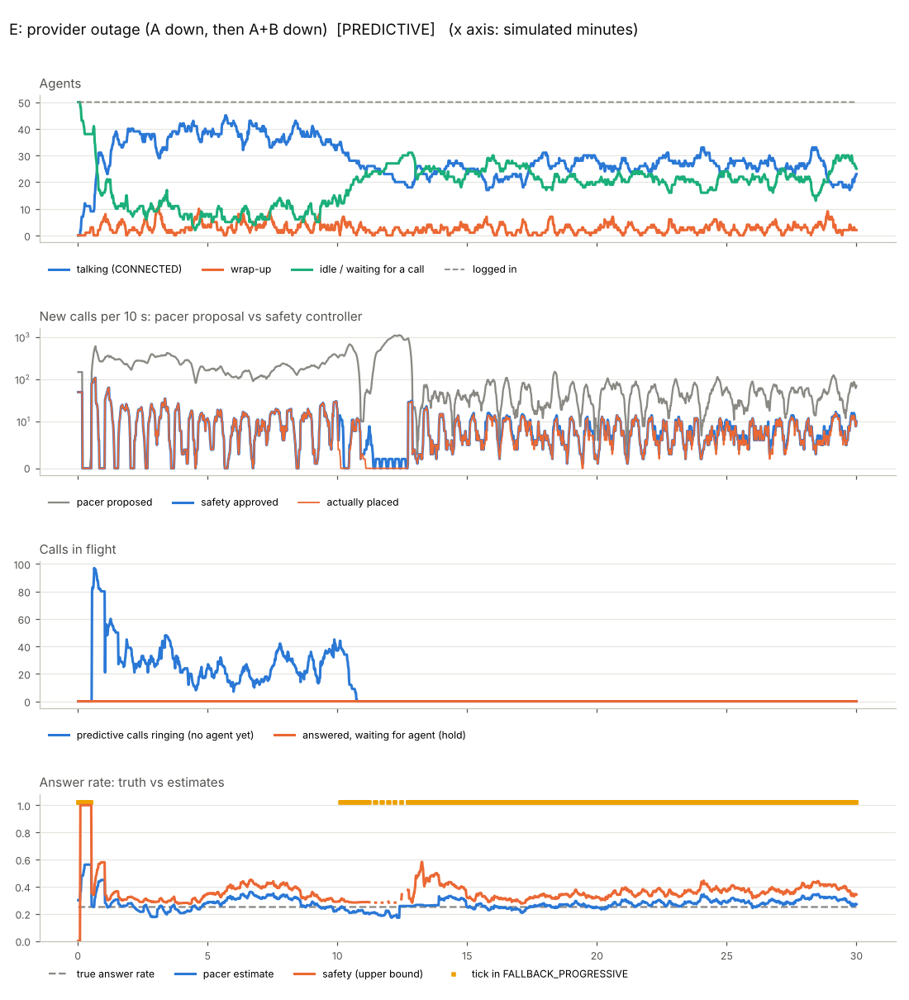

- utilization 57.3%, connected 426, abandoned 7 (1.64%), failed 66, cancelled 3, invariant violations 0
- safety decisions: `{"FALLBACK_PROGRESSIVE": {"ticks": 1146, "proposed": 7855, "approved": 933}, "REDUCE": {"ticks": 263, "proposed": 6657, "approved": 763}, "REJECT": {"ticks": 391, "proposed": 13028, "approved": 0}}`
- event handling: `{"ingested": 3744, "duplicates": 470, "applied": 3650, "stale": 94, "unknown": 0, "late_answer_after_cancel": 0, "errors": 0}`
- recovery: `{"setup_rolled_back": 0, "adopted": 0, "lost": 16, "unreconcilable": 22, "stale_reconciled": 0, "agents_repaired": 0, "borrowers_released": 0, "wrapups_forced": 0}`
- breaker_transitions: `{'provA': [(627, 'OPEN'), (642, 'HALF_OPEN'), (674, 'OPEN'), (689, 'HALF_OPEN'), (689, 'OPEN'), (704, 'HALF_OPEN'), (704, 'OPEN'), (719, 'HALF_OPEN'), (719, 'OPEN'), (734, 'HALF_OPEN'), (734, 'OPEN'), (749, 'HALF_OPEN'), (749, 'OPEN'), (764, 'HALF_OPEN')], 'provB': [(673, 'OPEN'), (688, 'HALF_OPEN'), (688, 'OPEN'), (703, 'HALF_OPEN'), (703, 'OPEN'), (718, 'HALF_OPEN'), (718, 'OPEN'), (733, 'HALF_OPEN'), (733, 'OPEN'), (748, 'HALF_OPEN'), (748, 'OPEN'), (763, 'HALF_OPEN'), (763, 'CLOSED')]}`

### F: agent drop (100 agents, 40 vanish in 3s)

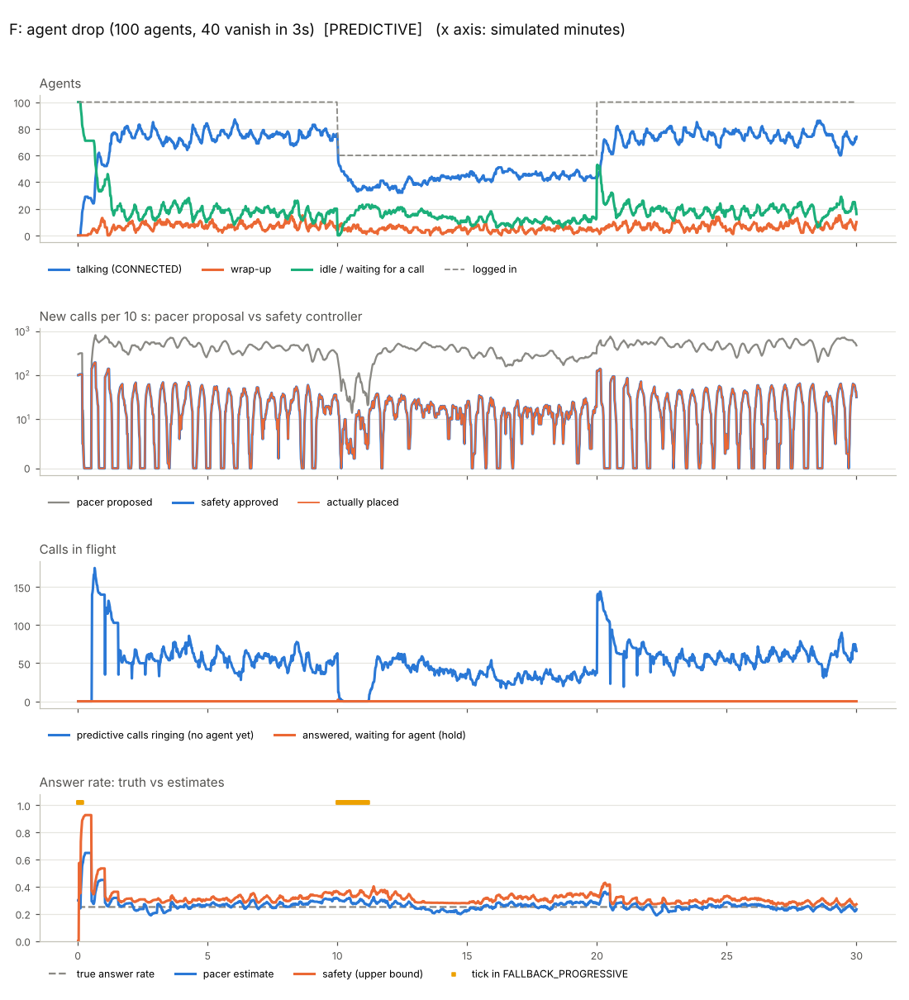

- utilization 71.7%, connected 1021, abandoned 2 (0.20%), failed 17, cancelled 46, invariant violations 0
- safety decisions: `{"APPROVE": {"ticks": 23, "proposed": 0, "approved": 0}, "FALLBACK_PROGRESSIVE": {"ticks": 79, "proposed": 650, "approved": 152}, "REDUCE": {"ticks": 808, "proposed": 36057, "approved": 3958}, "REJECT": {"ticks": 890, "proposed": 37327, "approved": 0}}`
- event handling: `{"ingested": 9086, "duplicates": 0, "applied": 9038, "stale": 48, "unknown": 0, "late_answer_after_cancel": 0, "errors": 0}`
- recovery: `{"setup_rolled_back": 0, "adopted": 0, "lost": 0, "unreconcilable": 0, "stale_reconciled": 0, "agents_repaired": 0, "borrowers_released": 0, "wrapups_forced": 0}`
- reaction_s_to_fallback: `1.0`
- shed_total: `46`

### G: answer-rate surge 10% -> 70%

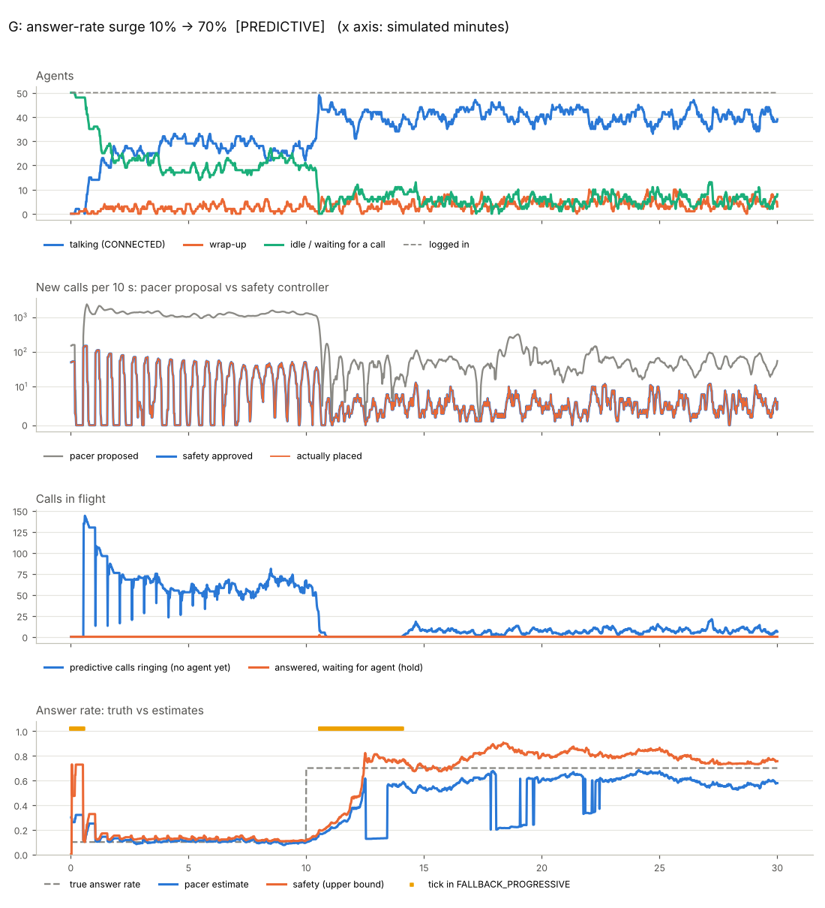

- utilization 69.8%, connected 552, abandoned 2 (0.36%), failed 9, cancelled 14, invariant violations 0
- safety decisions: `{"APPROVE": {"ticks": 20, "proposed": 2, "approved": 2}, "FALLBACK_PROGRESSIVE": {"ticks": 240, "proposed": 951, "approved": 141}, "REDUCE": {"ticks": 601, "proposed": 31924, "approved": 1972}, "REJECT": {"ticks": 939, "proposed": 50389, "approved": 0}}`
- event handling: `{"ingested": 4726, "duplicates": 0, "applied": 4710, "stale": 16, "unknown": 0, "late_answer_after_cancel": 0, "errors": 0}`
- recovery: `{"setup_rolled_back": 0, "adopted": 0, "lost": 0, "unreconcilable": 0, "stale_reconciled": 0, "agents_repaired": 0, "borrowers_released": 0, "wrapups_forced": 0}`
- seconds_until_p_safe_above_0.6: `143.0`

### H: only Provider B (slow, duplicates, reorder)

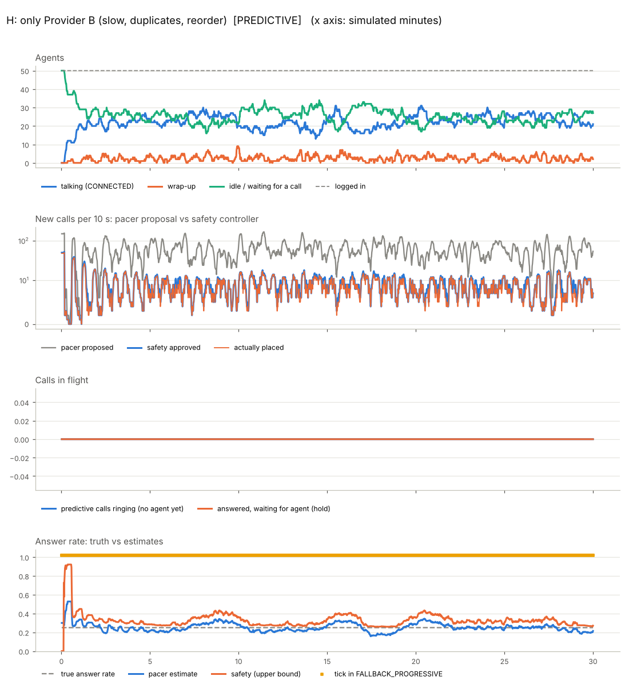

- utilization 44.0%, connected 376, abandoned 0 (0.00%), failed 83, cancelled 0, invariant violations 0
- safety decisions: `{"FALLBACK_PROGRESSIVE": {"ticks": 1800, "proposed": 10870, "approved": 1658}}`
- event handling: `{"ingested": 3690, "duplicates": 851, "applied": 3502, "stale": 188, "unknown": 0, "late_answer_after_cancel": 0, "errors": 0}`
- recovery: `{"setup_rolled_back": 0, "adopted": 0, "lost": 38, "unreconcilable": 0, "stale_reconciled": 0, "agents_repaired": 0, "borrowers_released": 0, "wrapups_forced": 0}`

### I: 3 workers, worker w2 crashes

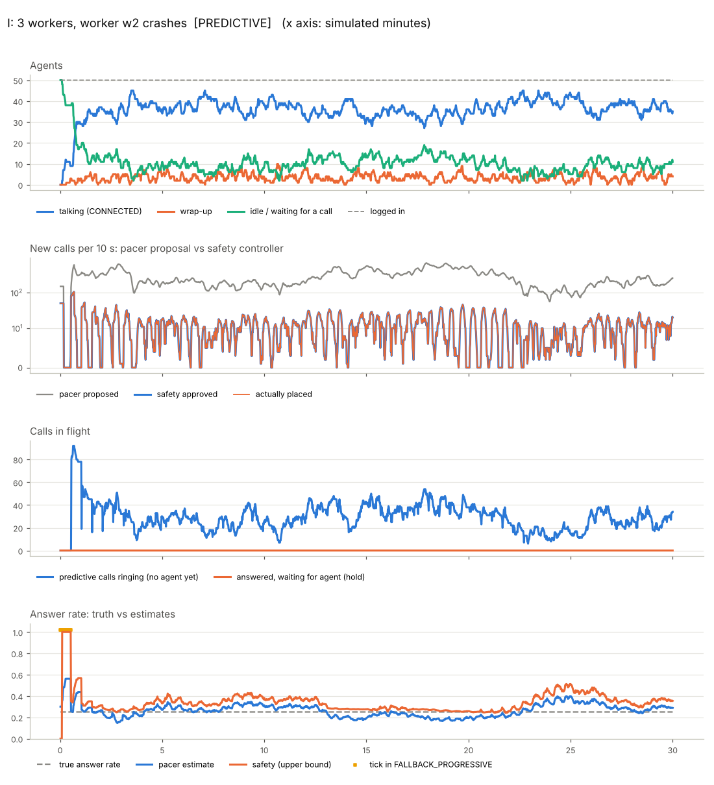

- utilization 71.8%, connected 559, abandoned 0 (0.00%), failed 10, cancelled 1, invariant violations 0
- safety decisions: `{"FALLBACK_PROGRESSIVE": {"ticks": 31, "proposed": 153, "approved": 50}, "REDUCE": {"ticks": 785, "proposed": 22947, "approved": 2239}, "REJECT": {"ticks": 984, "proposed": 25650, "approved": 0}}`
- event handling: `{"ingested": 5054, "duplicates": 0, "applied": 5053, "stale": 1, "unknown": 0, "late_answer_after_cancel": 0, "errors": 0}`
- recovery: `{"setup_rolled_back": 0, "adopted": 0, "lost": 0, "unreconcilable": 0, "stale_reconciled": 0, "agents_repaired": 0, "borrowers_released": 0, "wrapups_forced": 0}`

## Charts for the main scenarios

### A: answer 20%, talk 120s - PROGRESSIVE

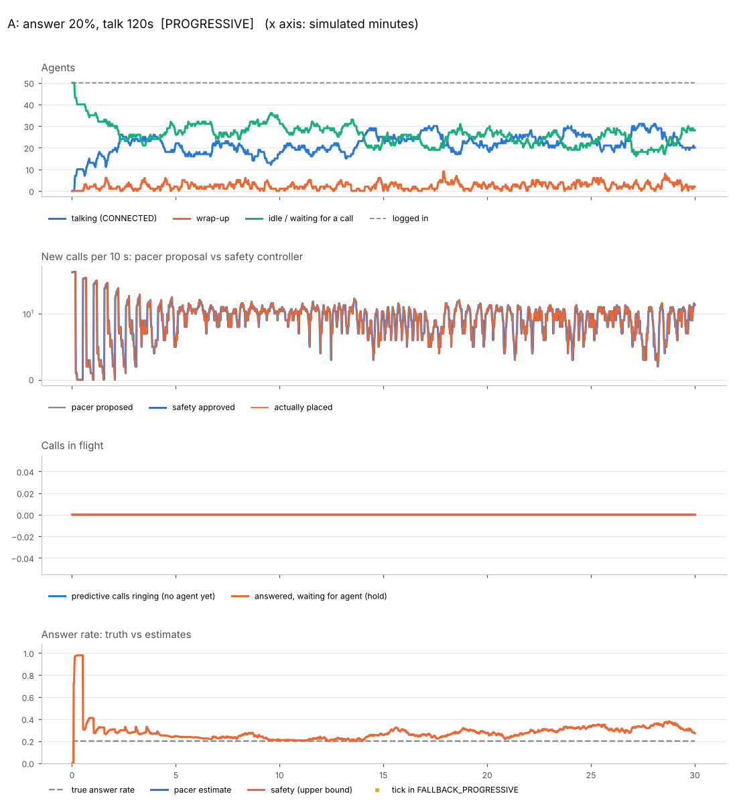

### A: answer 20%, talk 120s - PREDICTIVE

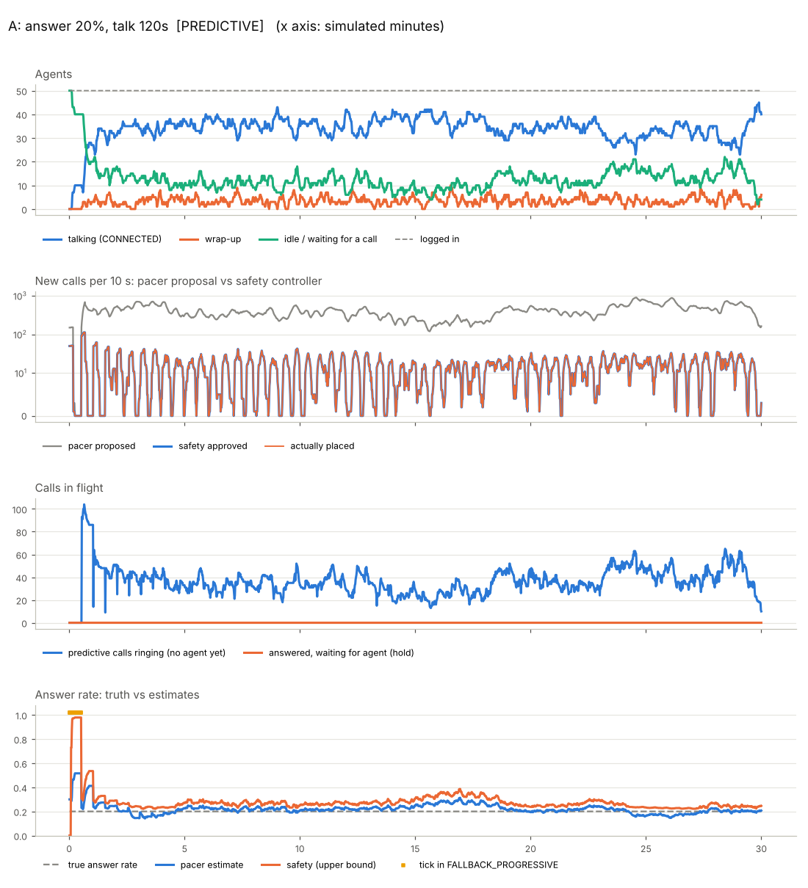

### B: answer 50%, talk 90s - PROGRESSIVE

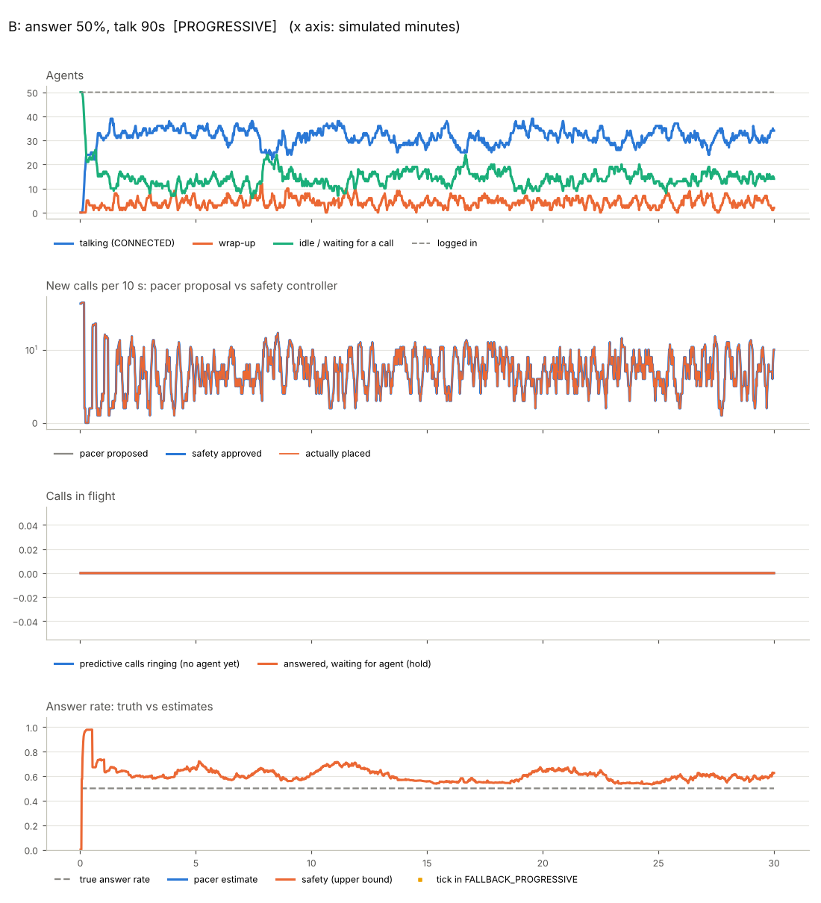

### B: answer 50%, talk 90s - PREDICTIVE

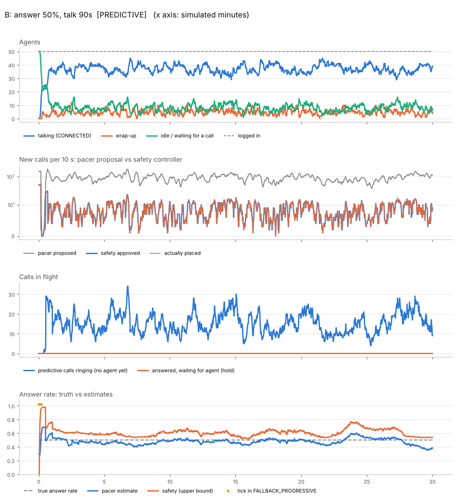

### C: answer 70%, talk 180s - PROGRESSIVE

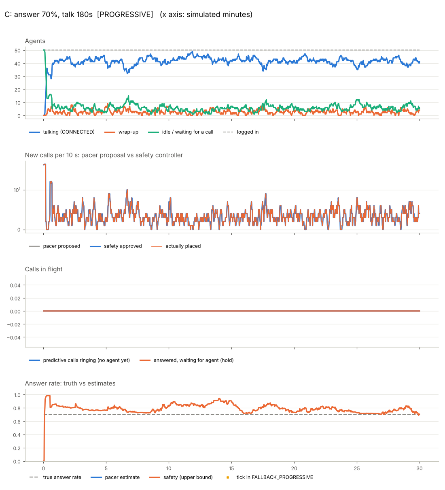

### C: answer 70%, talk 180s - PREDICTIVE

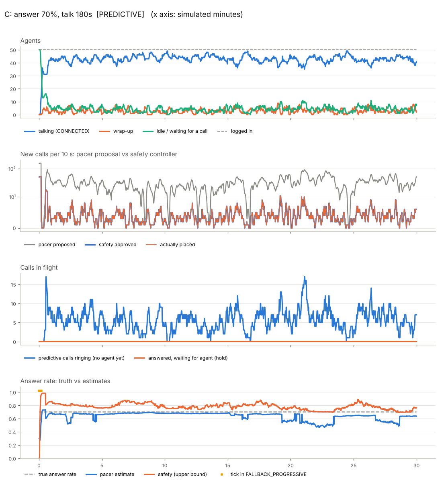

### D: changing (30%->65%->10%, talk 120->60->180s) - PROGRESSIVE

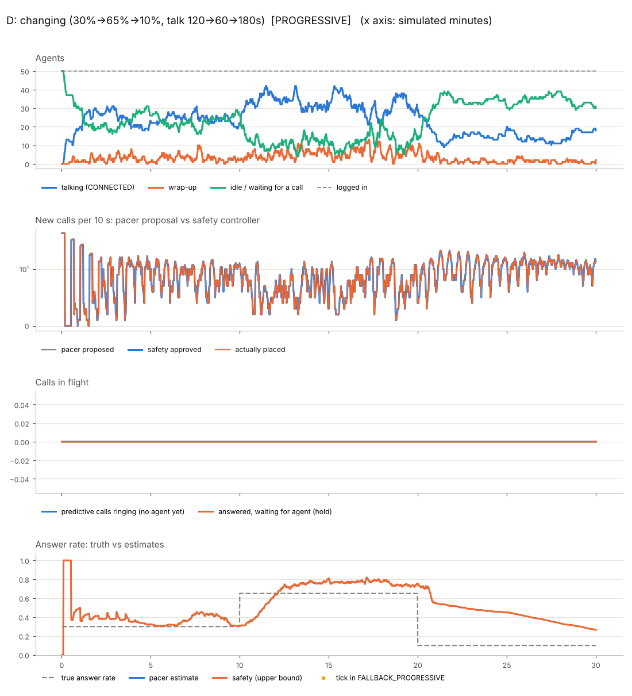

### D: changing (30%->65%->10%, talk 120->60->180s) - PREDICTIVE

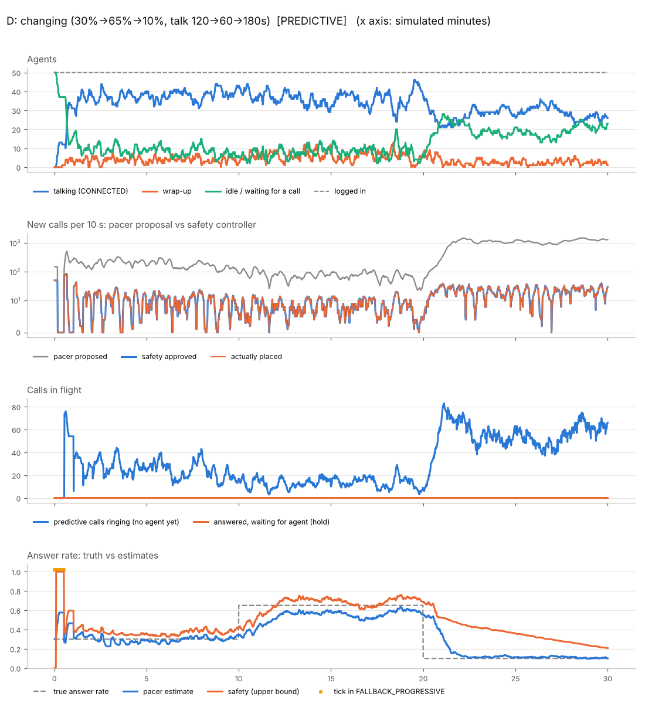
